# Tesla P4 cooling shroud (OpenSCAD)

Parametric, 3D-printable shroud that ducts one Noctua NF-F12 iPPC-3000 PWM (120 mm) through the heatsink of a passive NVIDIA Tesla P4. A sleeve slides over the far end of the card, stops flat against the end face of the cooling block, narrows into an 8 mm inlet channel the size of the fin block, and then widens through an 89 mm funnel to a bellmouth flange for the fan. The fan screws straight into heat-set inserts in the shroud's flange (direct mount); an optional spacer and 3 mm stator layer are available but do not fit the case length (see Length budget). A snap-on support clip, leg and adjustable foot carry the weight to the case.

> **Status: work in progress, not yet fit-tested or temperature-tested.** The CAD builds, exports and passes its own interference and air-path checks (`scripts/export.sh`). Several dimensions are still `[ASSUMED]` or `[REQUIRED]` in `cad/params.scad` (`params_confirmed = false`, so `--release` refuses to build); the biggest is `support_len`. Only the sleeve's slide fit on the card is measured so far; print the fit-check parts first (see [Fit validation](#fit-validation)) before the full shroud. **Neither the CAD nor the CFD validates cooling.** The CFD is comparative only (it ranks design changes) and has no heat transfer. Check the GPU temperature under load with `nvidia-smi`.

## Contents

1. [Layout and parts](#layout-and-parts)
2. [Orientation](#orientation)
3. [Design decisions](#design-decisions)
4. [Research and notes](#research-and-notes)
5. [CFD method and limits](#cfd-method-and-limits)
6. [CFD results](#cfd-results)
7. [Fan curve](#fan-curve)
8. [Fan control (Option A)](#fan-control-option-a)
9. [Print settings](#print-settings)
10. [Assembly order](#assembly-order)
11. [Fit validation](#fit-validation)
12. [Known limits](#known-limits)

## Layout and parts

| Path | Purpose |
|---|---|
| `cad/params.scad` | every parameter, tagged `[PUBLISHED]`, `[STANDARD]`, `[MEASURED]`, `[ASSUMED]` or `[REQUIRED]` |
| `cad/shroud.scad` | model; `part=` selects what to build |
| `scripts/export.sh` | STL export; fails on CAD errors, empty output, interference, or printed solid inside the air path |
| `scripts/preview.sh` | renders `output/preview_*.png` from the exported STLs (PyVista via `uv`; run after `export.sh`) |
| `cfd/`, `scripts/cfd.sh`, `scripts/cfd_post.sh` | comparative CFD (OpenFOAM in Docker); the fan and card exist only here |
| `docs/cfd-notes.md` | full CFD log: cases, tables, sensitivities, rejected concepts |
| `docs/fan-curve.yaml` | machine-readable starting fan curve for the controller |
| `MEASUREMENTS.md` | what is measured, what is still needed, prior art |
| `output/` | generated STLs, preview PNGs, `output/cfd/` CFD cases and plots |

Parts (`-D 'part="..."'`): `sleeve` / `sleeve_print` (the mouthpiece, joined to the shroud by one M3 into a heat-set insert in the shroud), `shroud`, `shroud_print`, `fitcheck_mouth` (a 5 mm slice of the sleeve wall for a quick fit test), `fitcheck_interface`, `fitcheck_fanface`, `spacer` / `spacer_print`, `stator_layer` / `stator_layer_print`, `stator_nose`, `seal_ring`, `support_clip`, `support_leg`, `support_foot`, `snap_comb`, `support_assy`, `interference`, and `airpath`.

**The fan and the GPU are never part of any CAD output.** They exist only in `part="interference"` (which must export empty) and in `cfd/`. `part="airpath"` also must export empty: it intersects the printed duct with the air path shrunk by `airpath_margin` (0.5 mm per side), so a wall or boss left inside the duct fails the export.

## Orientation

The case is a standing tower. The P4 fins face down (+Y) toward the metal PSU-shroud separator; the PCB back faces up toward the CPU cooler. Card coordinates: X is the flow axis (fan toward +X), Y is card thickness (fins toward +Y), Z is card height.

```
          CPU cooler
   ------------------------------   <- PCB back (up)
   |  PCB            ||||||||||  |
   ------------------------------   y = 0, fins start here
   fins (10 x 8 mm) pointing down  \
                                    \   shroud sleeve -> 8 mm channel -> funnel -> fan
   ==============================   <- PSU-shroud separator (metal)
          support leg + foot
```

Gravity acts along +Y, so the cantilevered fan and funnel sag toward the separator; the support leg stands on it. `fan_flush_y = "lo"` (default) keeps the fan edge level with the PCB-back side, so the funnel grows toward the fin side (down) and away from the CPU cooler.

Along the card height (Z) `fan_flush = "top"` is set: the fan edge is level with the top of the card and the funnel mouth grows toward the low-Z end, away from the card top. Installed, the motherboard is on the card-top (z = `pcb_h`) side, so the fan is level with it and the funnel grows away from it; the old `"bottom"` setting would push the funnel into the motherboard. In the slicer print view of `shroud_print` the mouth is on the RIGHT. The sleeve/shroud joint (lug, screw and insert boss) sits on the other side (`joint_side = "bottom"`), away from the board; the boss stands far enough out that the insert keeps `joint_boss_floor` from the flaring funnel.

Previews (generated from the exported STLs by `scripts/preview.sh`):

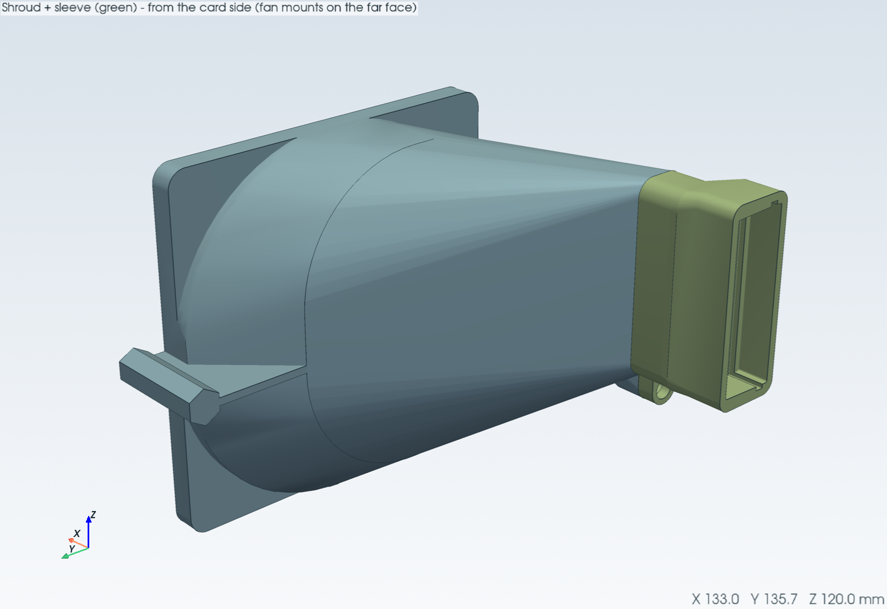
*Shroud from the card side; the fan mounts on the far face.*

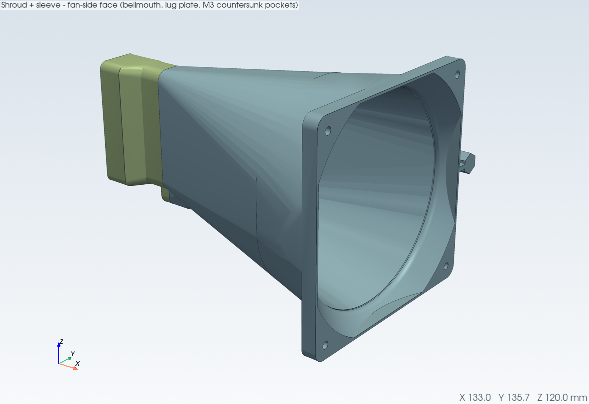
*Fan-side face: bellmouth opening, lug plate, M3 screw holes.*

## Design decisions

**Sleeve with a flat stop and a PCB pocket.** The shroud slides `grip` (10 mm) over the far end of the cooling block. The block's end face (its 6 mm solid base) seats on the step where the 8 mm channel starts (`stop_gap` 0.3 mm), so the fins feed the channel directly. The back cover ends flush with the block and seats on the same step. Only the bare PCB sticks out past the block, by `pcb_extra` = 1 mm ([MEASURED]), so it gets a small square-cornered pocket (2.8 mm thick: the 1 mm PCB plus `pcb_slot_extra_y` and `slide_clear` each side) that runs `pcb_end_clear` (1 mm, [ASSUMED]) past the PCB end: the PCB never bottoms out and the block takes the stop. The mouth rim is square, with no chamfer, so the full 2.4 mm wall bears on the card. It is a slip fit; real mounting is the support leg, not friction.

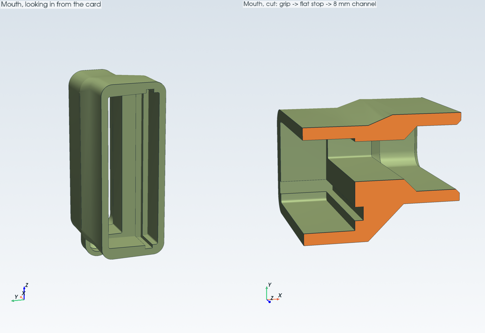
*The mouth seen from the card side and the cut grip, flat stop, 8 mm channel.*

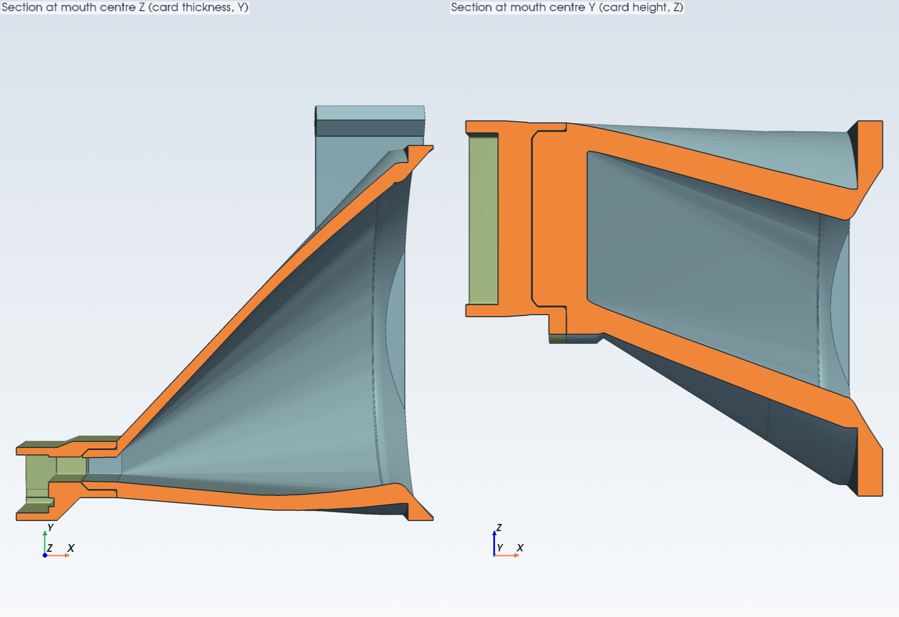
*Section through the mouth centre in both directions (cut faces in orange).*

**8 mm inlet channel.** The 14 mm cooling block is a 6 mm solid base next to the PCB plus 8 mm of fins on top (`hs_base`, [MEASURED]), so the fin passages, and the channel that feeds them, sit at the fin-tip side of the block (y = 6 to 14 mm from the PCB face), not against the PCB. Past the card end the inside narrows to the fin passage section (8 x 51.6 mm, 1.7 to 1.2 mm narrower than the block at each Z end). Any gap beside or above the fins is a bypass, and air takes the path of least resistance, so the channel closes it. The fit-check sleeve is the production sleeve with its full 10 mm grip (`grip`), so it slides over the card exactly as far as the shroud will:

**Stepped sleeve cavity and the slide fit.** The cavity copies the real cross-section of the card end, measured on your card: back cover 2 mm x 54 mm, PCB 1 mm x 56 mm, cooling block 14 mm thick, 54 mm wide at the PCB tapering to 53 mm at its far face. Each layer is grown by `slide_clear` = 0.65 mm on every side ([MEASURED], 2026-10-24: it started at 0.4, the fourth `fitcheck_mouth` slid on but was too hard to push, the fifth at 0.9 had far too much play, so v6 splits the difference), and the outside of the mouth is a plain rounded rectangle around the cavity: its bounding box grown by `wall` (2.4 mm), corner radius `sleeve_r` = 4 mm ([ASSUMED] looks choice; checked in 2D that the wall stays at least 2.4 mm everywhere up to R 4, while R 5 would thin it to 2.33). The PCB slot (the two notches where the PCB edges stick out past the back cover and the block) gets extra room on top of that, from the fit tests ([MEASURED], 2026-10-24): `pcb_clear_extra` = 0.25 mm more at each end and `pcb_slot_extra_y` = 0.25 mm more on each face of the board, so the PCB ends and faces get 0.9 mm in total and the slot is 2.8 mm wide. These are the v4 totals; v5 (1.4 mm per face, a 3.8 mm slot) felt like a second PCB would fit in. The slot corners are square (`offset(delta)`), not rounded like the rest of the cavity, so the board's square edge has room even after the printer rounds the inside corners. The extra width cannot make the card wobble, because the back cover and the fin block locate it, not the PCB slot. If the slot is loose, lower `pcb_slot_extra_y`. Note `pcb_t` = 1 mm is your measurement, while PCIe boards are normally 1.57 mm at the edge fingers [STANDARD]; worth checking with calipers. `back_clear_extra` = 0.25 mm gives extra room above the back cover (0.9 mm in total there, again the v4 value), because the third fit test was too tight there. Why a gap at all: a printed hole comes out smaller than modelled and the card edges are not perfectly square, so zero gap would bind. Too large a gap lets the sleeve rattle on the card and leak air around the block. The 0.4 mm starting value turned out too tight on your printer and 0.9 too loose, hence 0.65; the v6 `fitcheck_mouth` at these values fits well (you, 2026-10-24), so `sleeve_print` is ready for the final print. Print `fitcheck_mouth` first: it is only the 3 mm mouth outline (`fitcheck_mouth_len`, 15 layers at 0.2 mm), so it prints in minutes and tells you whether the card goes in. Then print `sleeve_print` (it is short, so it doubles as the full-length fit test) and slide it onto the card: if the card will not slide in, raise `slide_clear` (try 0.75); if it wobbles, lower it (try 0.55). The cavity is a straight extrusion along the card, so it prints without overhangs. The drawing below is a cut through the sleeve's mouth with the card outline in red.

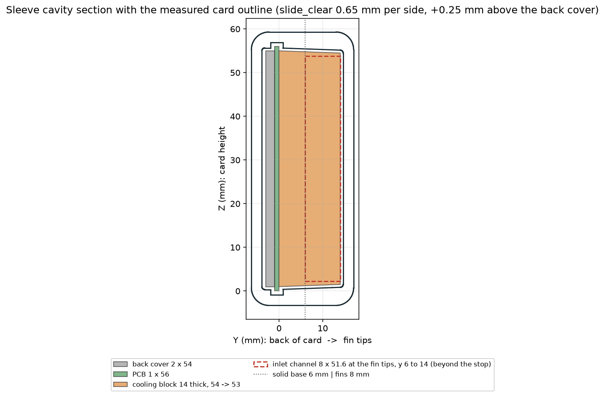
*Cut through the sleeve at the mouth, with the card end outline (back cover, PCB, tapered block).*

**Smooth outer shoulder.** The mouth's outside and the socket's outside are both rounded rectangles, so the shoulder between them is an exact loft: every side and the corner radius move linearly from one to the other, with no creases, ridges or slivers. (The earlier version hulled the stepped, cavity-following outline onto the socket; a hull between two different shapes leaves flat facets and small wedges where they meet, which is what you saw on the print.) Sides where the socket is smaller close in over `chan_step` (7.8 mm), 45 degrees at the steepest; the fin side (+Y), where the socket is bigger, is full size by `jt_x_o`, so the socket never sticks out as a wedge. The steepest overhang is about 45 degrees, so it prints without supports. `fitcheck_mouth` has the same new outside, but its cavity is unchanged, so the old and new versions give the same fit-test result.

**Sleeve/shroud joint.** The shroud's spigot (the 8 mm channel plus one `wall` per side) pushes `joint_overlap` = 9 mm into the sleeve's socket, with `joint_clear` = 0.2 mm per side and `joint_gap` = 0.1 mm short of the floor ([ASSUMED] print-fit choices). The socket floor is a 45 degree cone (so the sleeve prints without supports), and the spigot ends in a matching 45 degree nose (2026-10-24), (`joint_gap` + `joint_clear`)/√2 ≈ 0.21 mm off the cone. Before that the tip was square, which left an open triangle about 2.6 mm deep all around the duct, open to the air path. The nose ends in a `joint_nose_tip` = 0.6 mm flat ([ASSUMED]) instead of a knife edge, and the air passage through it is `joint_clear` narrower than the channel, widening back over `joint_taper` (10 mm). Only the shroud changed; the sleeve is the same part. The joint is a slip fit, so it is a labyrinth, not a hermetic seal: the only leak path is the 0.2 mm slip gap, 9 mm long. By the gap-cubed rule that is a small fraction of the flow (my estimate is well under 1 %; not measured). If you want it airtight, wrap the outside of the joint with aluminium tape or run a bead of sealant around it. If a print comes out oversize, the nose just bears on the cone, which seals better.

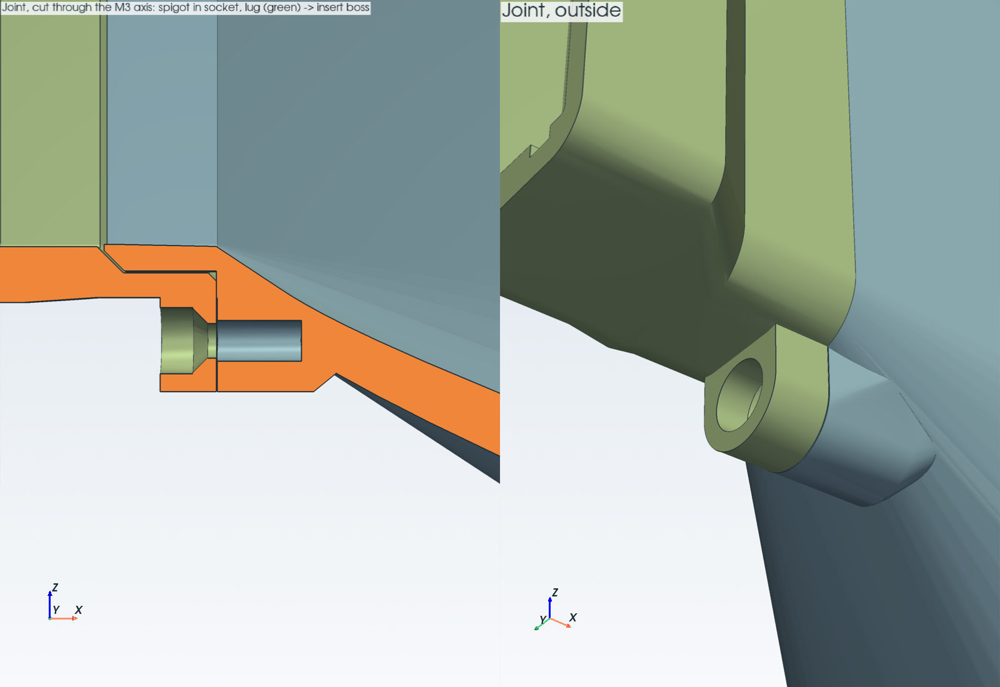
*Cut through the sleeve/shroud joint: the spigot's 45 degree nose follows the socket's cone floor.*

**Smooth outside, one piece look.** The outer surface flows from the sleeve into the shroud without steps; the inside (cavity and air path) is unchanged. The funnel starts with exactly the sleeve socket's outer section, so the joint is flush. The grip steps in with one continuous 45 degree shoulder (`chan_step`). The insert boss flares into the funnel wall over `boss_fair_len` (12 mm, `boss_fair_w` 3 mm per side) instead of ending in a flat cut. The funnel blends into the round fan collar over `shell_fair_len` (24 mm). These three are [ASSUMED] looks/printability choices. The collar is trimmed flush to the fan's 120 mm square (2026-10-24): it used to be a 123.3 mm cylinder (`shell_d`, sized to wrap the funnel's rounded corners) that bulged about 1.7 mm past the fan on each flat side. Now it is flat on the four sides and round only at the corners, so nothing sticks out past the fan's outline. On the flats the wall is the 120 mm square minus the bore: at least about 3.9 mm along the collar, 2 mm at the back of the flange, and 1.2 mm at the fan face (the same rim the bellmouth already left, `flare_rim`). These were measured by ray-casting the exported STL. The air path is unchanged, and `shell_d` still sets the support bar's height, so the bar and its clips did not move. The collar-to-flange edge is left sharp, because the flange corners and screw pockets must stay reachable.

**Length budget: the stack must end by X = 148 mm.** The case leaves about 150 mm from the card end to the next obstacle ([ASSUMED] 2 mm margin, `stack_max_len` 148, asserted; the build echoes the total). The stack is: sleeve and joint 22 mm (`x_s`, not changed) + funnel `trans_len` 89 + plenum `plenum_len` 4 + flange `flange_t` 8 (shroud ends at X 123) + fan 25 = 148 mm. It was 186 mm (funnel 106, plenum 10, flange 11, spacer 12; about 189 with the stator layer). Where it came from: funnel -17, plenum -6, flange -3, spacer -12 = -38 mm. The fan position relative to the case (`fan_flush_y`, `fan_flush`, `fan_off_z`) is unchanged.

**Funnel up to 52 degrees, `trans_len` 89 mm (was 45 degrees, 106 mm).** The walls move 105.1 mm sideways in the funnel (fixed by where the fan sits next to the card), so a 45 degree funnel needs 105 mm and does not fit the 148 mm budget. The straight-wall funnel is already the lowest peak slope for its length. At 89 mm the steepest wall is about 47.7 degrees from the axis (the build echoes it; `max_overhang_deg` = 52 is the [ASSUMED] allowance, asserted). Printed fan face down, that is a small overhang on the INSIDE face of the narrowing wall (the outside faces up and is supported). The flow is fan, narrowing duct, fins: a contraction, so the flow accelerates and tolerates steep walls much better than a diffuser would; the CFD below is a relative check of that. Print note: slow down and use maximum part cooling on the funnel; PETG and ASA generally bridge about 50 degrees, but the inside of the duct will be a little rougher (looks do not matter there). If your slicer flags the funnel, supports reached through the fan opening are fine. Not tested on a printer. Relative CFD (same fan curve and swirl model, no stator): the short stack gives 4.15 CFM through the fins against 4.19 for the long one, about -0.9 % (noise 0.1 %; `docs/cfd-notes.md`), so the steeper, shorter funnel costs very little in this model. A gentler taper loses less pressure: 140 mm was only +1.2 % in CFD (rejected earlier for length); a fifth-order polynomial funnel lost 22 % and added 92 mm; rejected.

**Splitter vanes removed.** The first design had flat splitter vanes (3 in Y, 2 in Z). In the steady RANS model, removing them and keeping the funnel and an open plenum gave 3.51 to 4.18 CFM (+19 %), fin-entry CoV 0.48 to 0.20, and the near-base share fell from 0.318 to 0.248, close to the area share (`docs/cfd-notes.md`). Caveat: their stiffness and print role is not modelled.

**Bellmouth at the fan face.** The flange opening follows the fan frame's flare so the air turns smoothly instead of over a sharp edge: a straight 45 degree cone from the fan face (flare diameter `fan_flare_d`, now 132), then a tangent arc that ends axial at `fan_open_d` (112), `flare_depth` (12 mm) from the face. The flare is wider than the 120 mm frame, so the opening is clipped to the frame (1.2 mm rim kept), in the CAD and in the CFD inlet alike. Diameters are estimates; measure them on your fan. The airflow gain is not validated.

**Direct mount (default) and the optional spacer.** To make the length budget, `stack_module` is now "none": the four fan screws (M3x10 from the fan side, through the fan's 4 mm corner tab) go into heat-set inserts pressed into the fan face of the shroud's flange. The fan stays serviceable from the fan side with the same four screws; there is no nut and no spacer. This needs the corner plate to be the whole `flange_t` = 8 mm thick (insert hole 6.5 mm + 1.5 mm; asserted), so the shroud's corner plate is `fl_lug` (= `flange_t` in direct mount, `lug_t` otherwise; `lug_t` itself is also the sleeve's lug and is untouched). Set `stack_module = "spacer"` to get back the modular stack below, but it adds 12 mm (160 mm total, over the budget; also raise `stack_max_len`).

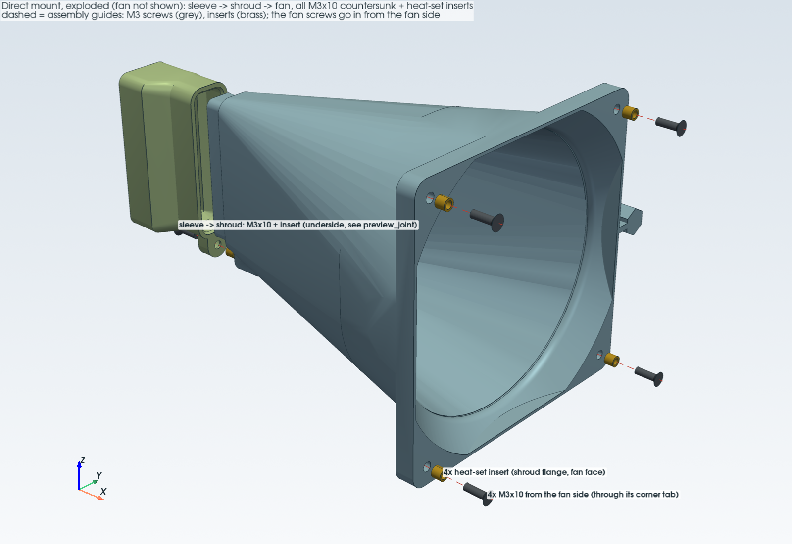
*The direct mount you print, exploded (the fan is not shown, by design). The red dashed lines are assembly guides, as in a manual: each fastener is pulled out along its axis, and the line runs through the holes it goes in. 4x M3x10 countersunk go from the fan side through the fan's corner tab into brass heat-set inserts pressed into the shroud flange's fan face, so the fan comes off with four screws. One M3x10 holds the sleeve to the shroud, into an insert in the boss on the underside (see the joint preview). The guide positions are echoed from `cad/shroud.scad` (`scad()` in `scripts/preview.py`), so they follow the CAD. The full modular stack (spacer, stator layer, nose puck, key ring) is shown exploded the same way further down (`preview_stack_modules`), and the parts on their own in `preview_modules` and `preview_stator`.*

**Modular stack with short screws (`stack_module = "spacer"`).** You only have short M3 screws and M3 heat-set inserts. So the stack is fan, then the 12 mm spacer, then (optionally) the 3 mm stator layer, then the shroud flange. Fan to spacer: M3x10 from the fan side. The head sits on the fan's corner tab (the flange on the face that touches the spacer), inside the open corner of the frame, and the screw goes through the tab into a heat-set insert in the spacer's fan face (never through the 25 mm frame). So the fan comes off with four screws and a hex key, without taking the stack apart; this needs room for the head and a 2 mm hex key between the fan's two corner flanges, which you should check on your fan. Spacer to shroud: M3 from behind the flange lug (through the stator layer, if fitted) into heat-set inserts in the spacer's shroud side. The stator layer has no holes at the fan screws any more, because nothing reaches it from the fan joint. Each joint is a tongue-and-groove with a loose TPU `seal_ring` key, because a joint leaks at 40-70 Pa. The fan-joint screw budget is asserted: the clamp is `fan_tab_t` (+ `seal_t` with a gasket) + the countersunk cone height `cs_head_h` (1.5 mm; on a flat tab the head can stand proud by that much), the insert hole `fan_hole_depth` = `screw_len` - clamp + `cs_head_h` + 0.5 (6.5 mm) takes the deepest reach, and at least 3 mm of thread must engage the insert (the build echoes 4 mm, shortest working screw 10 mm). The spacer must stay 1.5 mm thicker than that hole, and the inserts must clear the bellmouth by 1.5 mm; both are asserted.

**Countersunk heads.** Your M3 screws are countersunk (flat top, 90 degree cone under the head), so every head pocket is a 6.5 x 3.2 mm counterbore (it keeps the head recessed and leaves room for the driver) with a 90 degree countersink at its floor (`screw_head = "countersunk"`; `"flat"` brings back the plain counterbore for pan or socket heads). A countersunk screw's nominal length is measured from the flat top of the head, which now sits at the pocket floor, so the screw reaches as far as the old flat-head budget assumed. The seat is `cs_clear` (0.3 mm, [ASSUMED]) wider than the 6.0 mm head ([STANDARD]), so the head sinks about 0.15 mm deeper (`cs_drop`); the screw-depth budgets include that. The cone is 1.45 mm deep, and the build asserts at least `cs_land` = 0.8 mm of straight hole below it: the lug floors are 2.3 mm and the fan-well floor 2.4 mm. In a flat pocket a countersunk head would bear only on the hole edge, sit 1.3 mm proud and crush the plastic. The cones print without supports: in the shroud and sleeve they open upward, in the spacer they are a 45 degree ceiling over the well.

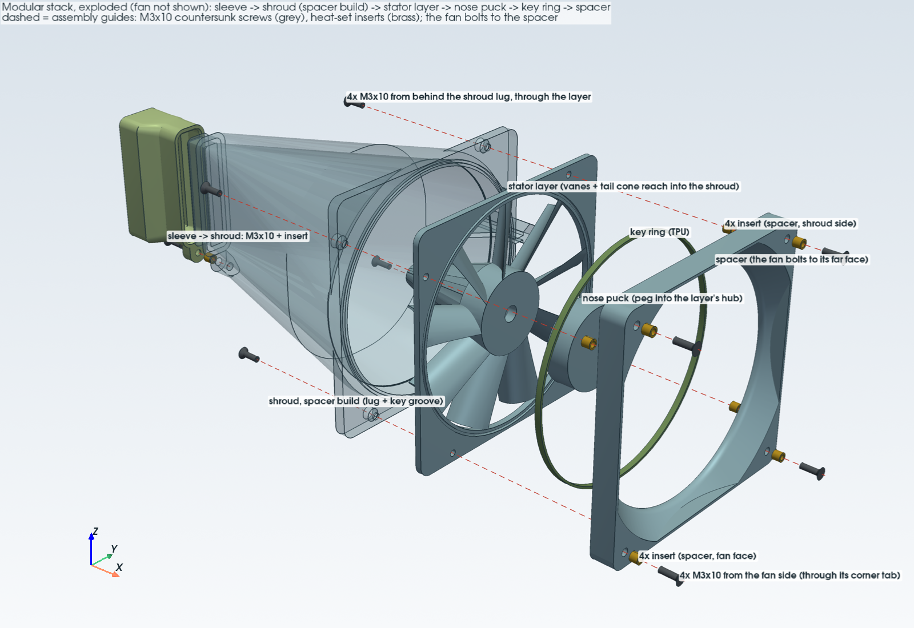
*The full modular stack, exploded along the fan axis in the same manual style (the fan is not shown). From the card side: the sleeve, the shroud built for the spacer stack, the stator layer, the nose puck, the TPU key ring and the spacer; the fan would bolt to the spacer's far face. This shroud is not the one you print by default. Built with `stack_module = "spacer"`, its corner plate is the thinner `lug_t` lug with four countersunk pockets on the back and a key groove on the front, instead of the direct mount's 8 mm flange with fan inserts. It is exported as `output/shroud_spacer.stl` for this preview only; to print it, build `shroud_print` with the same `-D` flags as `scripts/export.sh` uses (`spacer_cfg`). The stator layer's tongue drops into that groove, and its vanes and tail cone reach back into the shroud's bore, so here they show through the shroud's opening. The nose puck's peg goes into the socket in the layer's hub. The key ring sits in the facing grooves of the layer and the spacer. Red dashed guides: one M3x10 holds the sleeve to the shroud as in the direct mount. 4x M3x10 go in from behind the shroud's lug, through the stator layer, into heat-set inserts in the spacer's shroud side (the shroud is drawn see-through here so all four of these heads show). 4x M3x10 go in from the fan side, through the fan's corner tab, into inserts in the spacer's fan face. Only the parts are pulled apart for the picture; the gaps between them mean nothing. The screw and insert positions are echoed from `cad/shroud.scad` in the spacer configuration. `scripts/export.sh` builds the spacer, stator layer, nose puck and key ring in that same configuration, so their own checks run.*

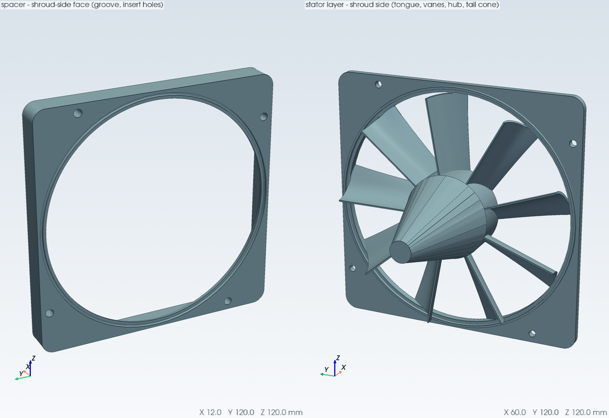
*Left: the spacer's shroud-side face (key groove, insert holes). Right: the stator layer from the shroud side (key tongue, 9 vanes, hub, tail cone).*

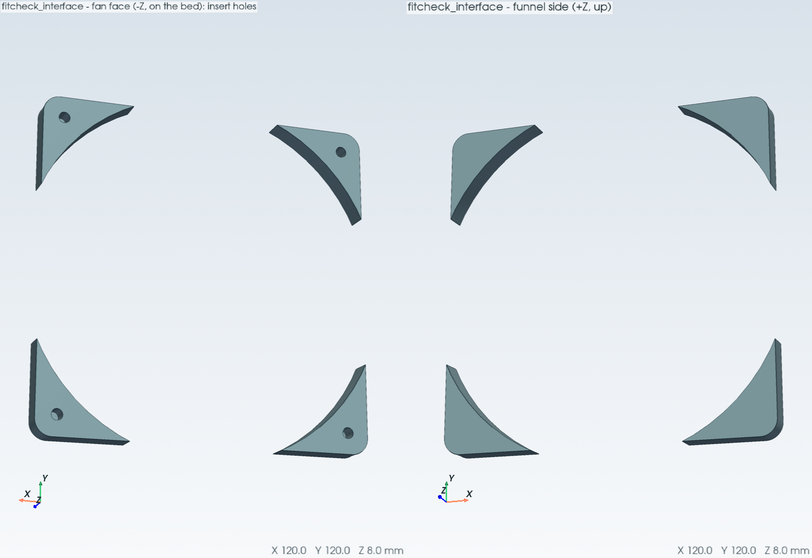
*`fitcheck_interface`: an 8 mm copy of the shroud's corner plate with the four fan insert holes (4.0 mm, 6.5 mm deep, 105 mm pattern), fan face on the bed. Press the heat-set inserts in, then screw the fan on with the M3x10 countersunk screws from the fan side, exactly as on the shroud.*

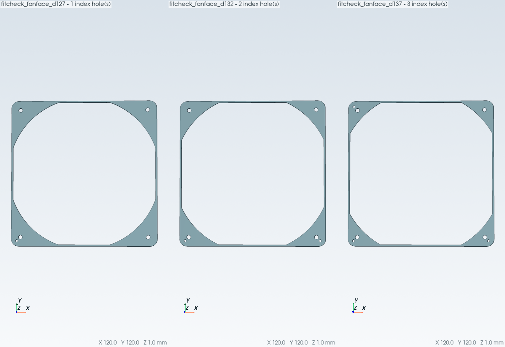
*`fitcheck_fanface_d127`, `_d132`, `_d137` (1, 2, 3 index holes): 1 mm coupons of the fan-contact face. Lay each on the fan to see which flare diameter matches.*

**Stator layer status: does not fit the case length, off by default.** The layer sits between a spacer and the shroud, so it needs the spacer (12 mm) plus its own 3 mm: the stack would be 148 + 12 + 3 = 163 mm (against 148 allowed; it was 189 before). `stator_layer = false` stays the default, and `stator_layer = true` asserts that a spacer is used. `scripts/export.sh` still builds it (with `stack_module "spacer"`, `stack_max_len` raised) and reports a WARNING instead of failing if it collides with the case keep-outs. The 60 mm tail cone is now auto-limited to what clears the shorter funnel (46 mm; `tail_len` stays 60, the build prints a NOTE). The CFD figures for the stator below were run with the long funnel and a 60 mm tail, so they do not apply to this geometry.

**Stator layer (long-funnel design).** An optional `stator_layer_t` = 3 mm plate ([ASSUMED] design choice) that slips in between the spacer and the shroud flange, so the stack without it is unchanged and you can A/B test it by taking it out. It has the same 120 mm outline, bore and stack-screw holes as the spacer. On the shroud side it has an integral key tongue that drops into the shroud's groove; on the spacer side it has a groove for the loose TPU `seal_ring`, as the spacer-to-shroud joint had before. The vanes and the hub stick out of the plate on the shroud side: the plate carries only the first 3 mm of the 14 mm chord (`stator_chord`), and the other 11 mm reach into the shroud's straight 112 mm bore, with the vane tips 0.4 mm (`vane_tip_clear`, [ASSUMED]) inside it. So the shroud needs no change. 9 fixed vanes (9 and 7 share no factor; the NF-F12 is assumed to have 7 blades, [ASSUMED], no authoritative published count found), 40 mm hub (`fan_hub_d`, [MEASURED]). The vanes are cambered and twisted (`stator_vane = "cambered"`, the default): the inlet angle from axial runs from 60 degrees at the hub to 75 degrees at the tip (`stator_in_hub`, `stator_in_tip`, [ASSUMED] to match the swirl model: the axial speed at the fan face is only about 0.24 m/s, so the flow is nearly tangential and tan(angle) grows with radius), the outlet is axial (`stator_out_deg` = 0), the profile is a circular-arc camber line with a rounded leading edge (`stator_le_frac`) and a thin trailing edge (`stator_te_t` 0.6 mm), 14 mm chord. The old straight 45 degree slab is kept as `stator_vane = "flat"` for A/B.

**Print orientation and supports for the cambered vanes.** Print the layer with the spacer-side face on the bed, hub, vanes and tail cone up (`part="stator_layer_print"`). The cambered vanes lean 60 to 75 degrees from the axis at the plate and straighten toward the trailing edge, so the underside (the concave face) of each vane overhangs the plate and needs removable supports there; the hub, the tail cone (18 degrees from vertical) and the convex faces do not. The supports sit in the open gaps between vanes and are reachable from the open end, but this is read off the geometry, not from a slicer run: check it in your slicer and use tree or organic supports with a small contact distance. The flat 45 degree vanes need no supports. The 60 mm tail cone (`tail_len`, half angle 18 degrees) continues from the hub into the funnel; the longest that clears the funnel walls by 2 mm is 69 mm.

Why there and not a thicker spacer: the stack screws go from behind the shroud's lug into heat-set inserts in the spacer, and the layer just adds 3 mm to the clamped stack. With M3x10 that is 4 mm of thread in the 4 mm inserts (full engagement with or without the layer; asserted at 3 mm or more, and the build echoes the shortest working screw per joint). The fan joint does not change at all. The vane leading edges sit at the spacer's shroud-side face, 12 mm (`spacer_t`) from the fan's outlet face, which keeps them at least `stator_gap` = 10 mm from the blades.

The nose: the hub would leave a 12 mm hole in the middle of the spacer's bore, behind the fan's hub. A separate `stator_nose` puck (40 mm across, `spacer_t` - `nose_gap` = 12 mm tall) fills it. Its 8 mm peg presses into a socket in the hub (`nose_peg_d`, `nose_peg_len`, `nose_peg_clear`, all [ASSUMED]), and its flat face ends flush with the fan's outlet face (`nose_gap` = 0), so it continues the fan's own hub with no step. This assumes the fan's hub on that side does not spin and does not stand proud of the frame (check, or set `nose_gap`). A one-piece hub with the nose would need supports; as two parts both print flat. `stator_layer_print` prints with its spacer-side face on the bed and the vanes, hub and cone up (the vanes' 45 degree leading edges and the 18 degree cone print without supports); the puck prints on its flat face.

With the layer fitted, the fan sits 3 mm further out. Set `stator_layer = true` for the assembly view and the interference check (`scripts/export.sh` runs the check both ways). Whether the stator helps is a print-and-measure A/B test against the plain spacer. In the CFD the cambered vanes gave about +6.5 % over the spacer and the hub alone about +3 %, both on an assumed fan curve and an assumed swirl model; see [CFD results](#cfd-results). Not a cooling validation.

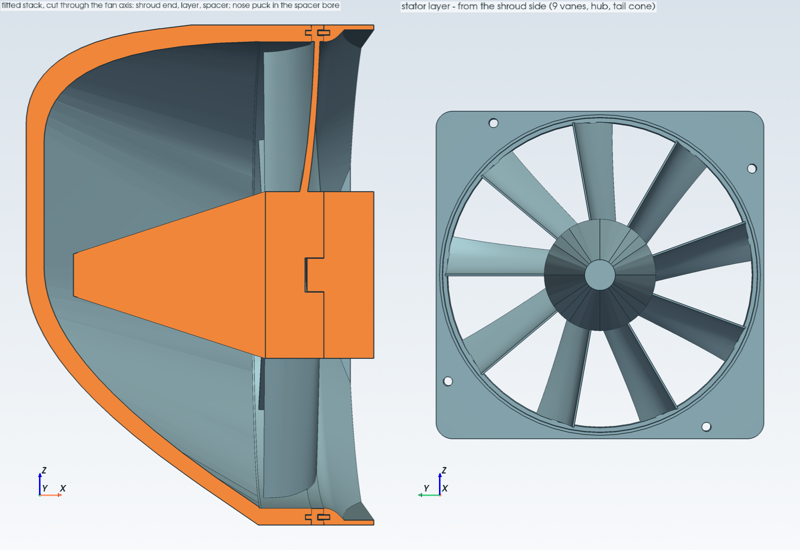
*Left: the fitted stack cut through the fan axis (cut faces orange): the end of the shroud, the stator layer with its vanes and tail cone reaching into the shroud's bore, the key ring at the layer/spacer joint, the nose puck pegged into the hub, and the spacer. Right: the stator layer seen along the axis from the shroud side, with the 9 vanes between the hub and the bore.*

## Research and notes

**Fin analysis.** You counted 10 fins across the block; the finned width is unmeasured and taken as 51.6 mm, so the pitch is about 5.16 mm. The passages are rectangular ducts of about 4.4 to 4.9 x 8 mm, hydraulic diameter about 6 mm. That is laminar developing flow, Re about 2000 to 3600 at these flows (laminar to transitional). Air temperature rise follows `dT = P / (rho cp Q)`; that is air only, not die temperature. An earlier 1.8 mm pitch guess was far too pessimistic and was dropped.

**Fan choice.** The duct plus 170 mm of 10 narrow passages is high resistance, so the fan runs close to shutoff. Static pressure is the lever, not free-air CFM. The first fan, an NF-P12 redux-1700 (2.83 mmH2O), was replaced by the NF-F12 iPPC-3000 (7.63 mmH2O = 74.8 Pa, 186.7 m3/h at 3000 rpm), about 2.7 times the pressure. The first CFD with the NF-P12 gave only 2.43 CFM.

**Fan laws.** Pressure scales with rpm squared, flow with rpm. A temperature-based PWM curve trades noise for flow.

**Two fans in series.** Gives clearly less than 2 times the pressure, because the second fan sees swirled air. A stator between them or a counter-rotating pair gets closer. `fan_stack = 2` is kept for information, not as the default.

**Stator and swirl.** Swirl leaving the fan is lost as mixing in the funnel; a stator turns it into static pressure. The CFD sensitivity "swirl off" gave +15 %, an upper bound on what recovering all the swirl could bring in this model (the fan model has no real swirl, so it is not a prediction). Limits: the NF-F12 frame already has outlet struts, so only residual swirl is left; near shutoff the axial speed at the fan face is only about 0.3 m/s, so the flow angle is steep; the cambered vanes need removable supports (see above); the vane count shares no factor with the blade count (tonal noise); at least 10 mm from the blades. Use the plain spacer as the control and compare `nvidia-smi` temperatures at the same PWM and load. The stator CFD (below, under CFD results) found the hub worth about +3 % and the cambered vanes about +3.5 % more, in this assumed model.

**Exit diffuser.** A 50 mm diffuser after the fins gave +6.3 % in CFD. That is an ideal upper bound; it is not in the CAD because of space.

**Leaks.** Leakage scales roughly with the gap cubed. In CFD, a 150 mm2 leak cost only 0.55 %, but the leak area is unmeasured. Seal joints with the TPU key ring, foam, or aluminium HVAC tape.

## CFD method and limits

`scripts/cfd.sh` meshes the air volume with snappyHexMesh and solves it with `porousSimpleFoam` (OpenFOAM v2512 in Docker, steady RANS, about 380k cells, a coarser c4 mesh for most runs). It fails on any step error, a failed `checkMesh`, NaN, or an inlet/outlet mismatch above 1 %. `scripts/cfd_post.sh NAME` writes slice images to `output/cfd/NAME/`.

- The fins are a calibrated Darcy-Forchheimer porous zone, not resolved geometry. `fin_pitch` comes from a count of 10; `fin_t` and `fin_k` are guesses (`fin_t` 0.8 mm gave -11.5 %).
- The fan curve shape is `[ASSUMED]`; only the two datasheet points (74.8 Pa, 186.7 m3/h) are published. A linear curve gave +3.7 %.
- No heat transfer. The numbers rank design changes; absolute flow is uncertain by 15 % or more.
- The duct is sealed except where a sensitivity case says otherwise. Leaks and bypass over the fins are unmeasured.
- Mesh: c3 4.135 vs c4 4.177 CFM (-1.0 %). Run-to-run noise is about 0.3 %; the regression threshold is 1 %.
- Turbulence model: kOmegaSST gave +1.2 % versus the default.

## CFD results

All images below are from `output/cfd/`. Velocity colours are not on a common scale across cases; read each colour bar. In the side views the fan is at the left and +X points left.

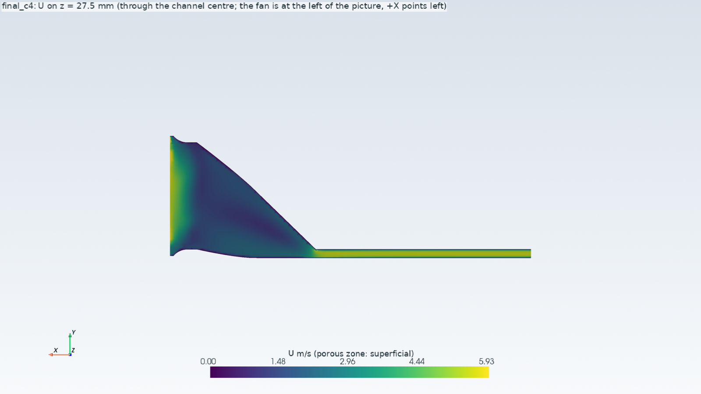
*Final design (no vanes), 3000 rpm: velocity on z = 27.5 mm. Flow fans out of the funnel and accelerates into the 8 mm channel (the fin block is a porous zone, shown by its superficial velocity). 4.175 CFM.*

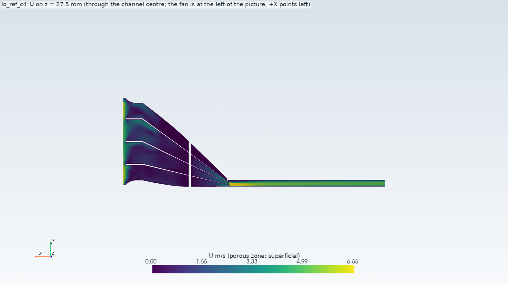
*Old design with 3 and 2 splitter vanes (the white lines are the vane plates): the flow is split into lanes and enters the fins unevenly. 3.510 CFM.*

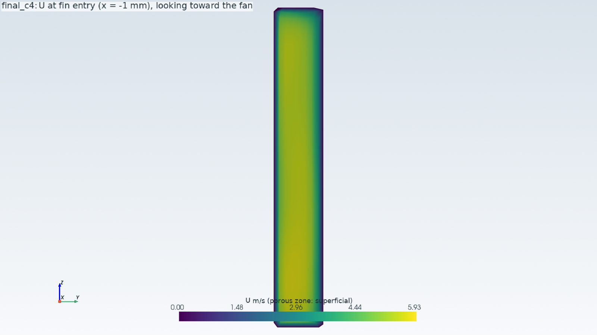
*Final design: velocity over the fin entry (x = -1 mm, looking toward the fan). Fairly uniform; CoV 0.204.*

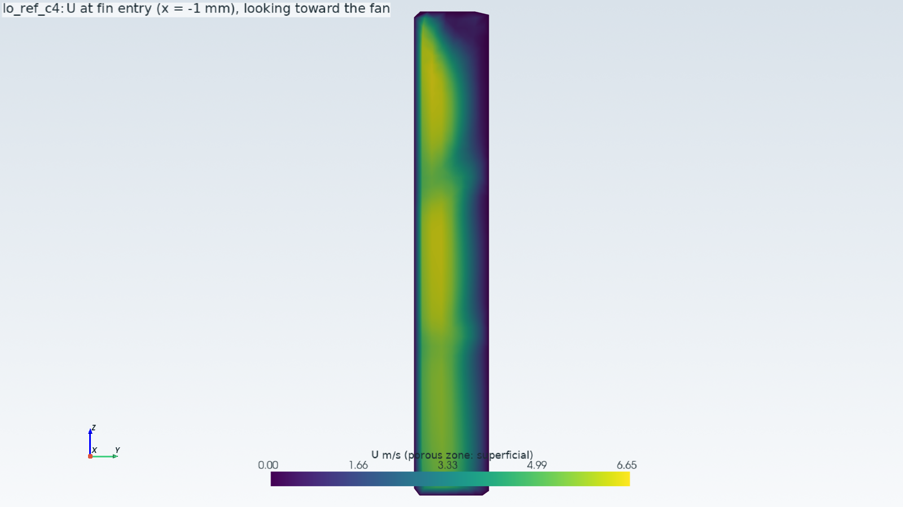
*Old design: fin-entry velocity is patchy, concentrated in lanes between the vanes. CoV 0.479.*

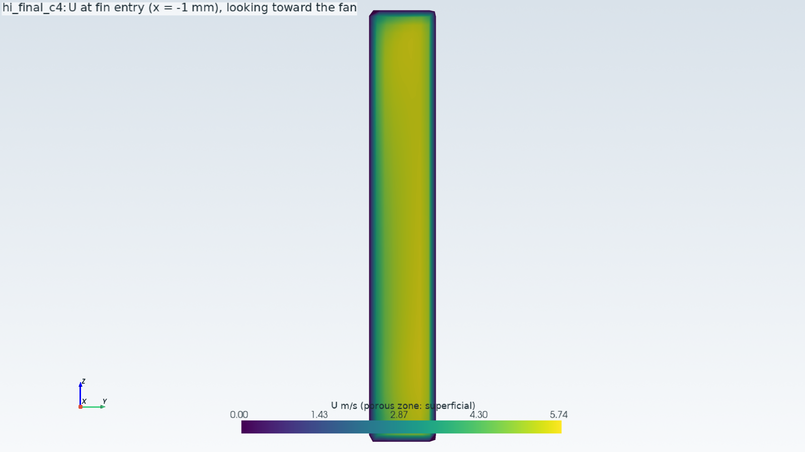
*Final design with `fan_flush_y = "hi"`: slightly more even (CoV 0.166), 4.224 CFM; the difference from "lo" is small.*

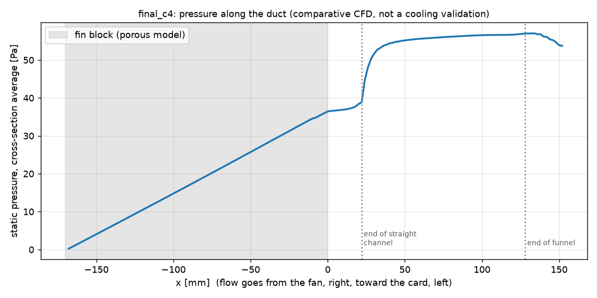
*Cross-section average static pressure along the duct for the final design. The fin block (grey) is the linear ramp, about 37 Pa; the funnel, plenum and fan face account for the rest (about 16 Pa outside the fins).*

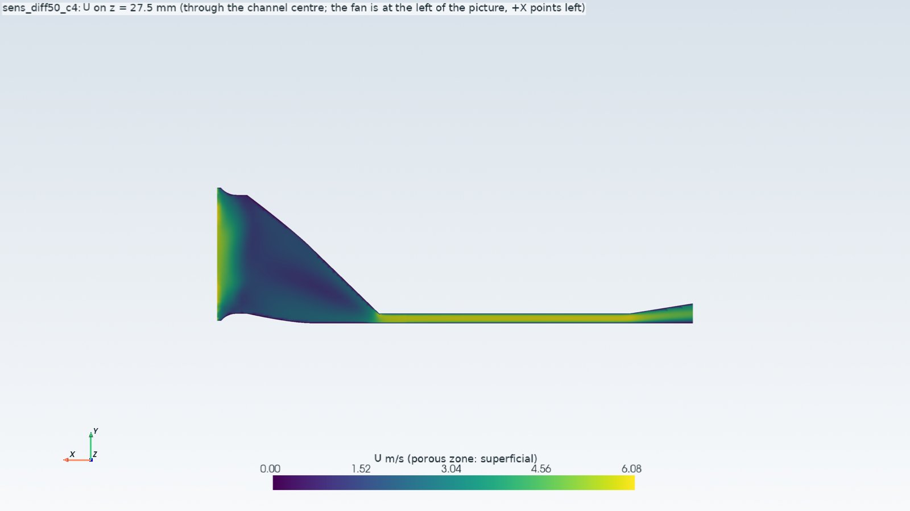
*Sensitivity only, not in the CAD: a 50 mm exit diffuser after the fins gives +6.3 % in this model (an ideal upper bound).*

| Case | Q (CFM) | CoV | near-base share |
|---|---|---|---|
| Old (vanes 3/2) | 3.510 | 0.479 | 0.318 |
| Final, "lo" | 4.175 | 0.204 | 0.248 |
| Final, "hi" | 4.224 | 0.166 | 0.188 |

### Stator layer (2026-10-24)

Same solver, cell 4, 5000 iterations, the fan at its real stacked position (`cfd_stack`), all runs on the same geometry (cavity clearances pinned). The control is the plain 12 mm spacer. Run-to-run noise is 0.09 %. The swirl is an assumed solid-body model ([ASSUMED]: +X spin, 6.4 m/s at r = 40 mm); these are comparative numbers, not a cooling validation. The runs were made on the longer 21 mm bore; the case length has since been cut, so read them as rankings.

| Case (swirl +X, vanes matched, `stator_hand` -1) | Q (CFM) | vs spacer |
|---|---|---|
| Spacer only (control) | 4.207 | - |
| Hub + tail, no vanes | 4.331 | +2.9 % |
| **Hub + 9 cambered vanes, 14 mm chord, 60/75 degrees (default)** | **4.484** | **+6.6 %** |
| Inlet angles 70/82 degrees | 4.478 | +6.5 % |
| Inlet angles 50/68 degrees | 4.480 | +6.5 % |
| 11 vanes instead of 9 | 4.490 | +6.7 % |
| Old flat 45 degree vanes (earlier geometry, 21 mm bore) | 4.329 | +2.5 % (vs its own control 4.222) |

What it means: the hub is worth about +3 % and the cambered, twisted vanes add about +3.5 % on top, in this model. Inlet angle (50 to 82 degrees) and vane count (9 vs 11) are all inside 0.2 %, so the defaults are not sharp optima: it is a plateau, and any of them is as good as another here. Chord 20 mm did not pass the 1 % mass-balance gate and does not fit the shorter bore anyway. Spin direction: the reversed spin (swirl -X with hand +1) failed the gate at 5000 iterations twice and was not re-run at 8000, so the hand dependence is open; the earlier flat-vane run with the wrong hand lost 1.6 % against the matched one, so `stator_hand` matters. Rotation direction and blade count are [REQUIRED]/[ASSUMED]: no authoritative published source was found. Details: `docs/cfd-notes.md`.

### Older sensitivities

Sensitivities against the final design: swirl off +15 %, hub blockage off +12 %, `fin_t` 0.8 mm -11.5 %, leak 150 mm2 -0.55 %, kOmegaSST +1.2 %, linear fan curve +3.7 %, diffuser 50 mm +6.3 % (ideal), 2 mm bypass over the fins +8 % (not a real gain: the extra flow bypasses the fins). Concepts tried and rejected: vanes_y3/z0 -10 %, trans 140 mm +1.2 %, poly5 funnel -22 %, open116 -0.5 %. The full tables are in `docs/cfd-notes.md`.

## Fan curve

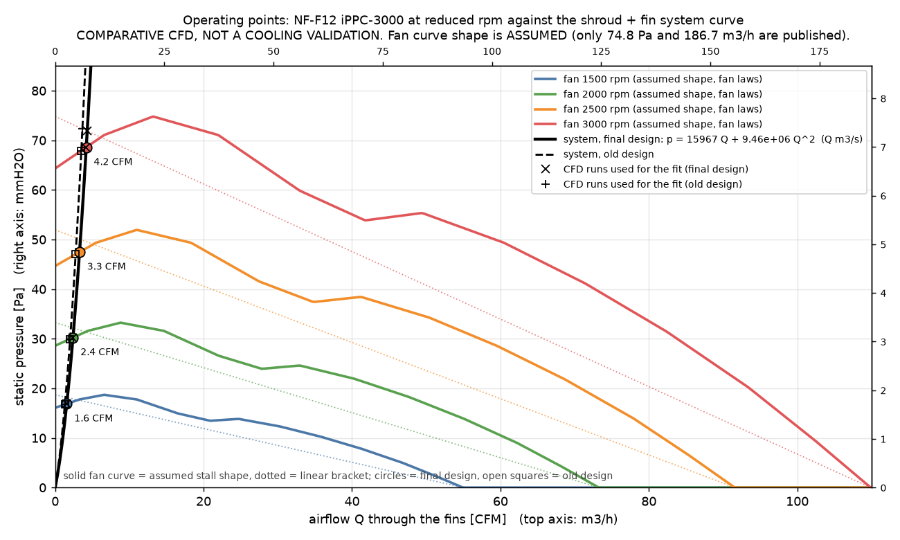
*Fan curves at reduced rpm (assumed stall shape, fan laws) against the shroud system curve `p = 15967 Q + 9.46e6 Q^2` (Q in m3/s). Circles: final design; open squares: old design. Comparative CFD only; only 74.8 Pa and 186.7 m3/h are published.*

CFD at four speeds (final design, from `output/cfd/rpm_table.csv`). The air temperature rise is `P / (rho cp Q)`: air only, not die temperature.

| rpm | CFM | dP fins (Pa) | dT air at 50 W (K) | dT air at 75 W (K) |
|---|---|---|---|---|
| 1500 | 1.56 | 10.7 | 56.3 | 84.5 |
| 2000 | 2.40 | 18.1 | 36.6 | 54.9 |
| 2500 | 3.28 | 26.9 | 26.7 | 40.1 |
| 3000 | 4.19 | 37.2 | 21.0 | 31.4 |

The old design reached 3.51 CFM at 3000 rpm; the final design reaches 4.18 CFM at the same speed, and at 2500 rpm (3.28 CFM) it is within about 7 % of the old design at 3000 rpm. 1500 rpm is too low for 50-75 W: an air rise of 56-85 K means the card would overheat. This is a flag, not a prediction.

The datasheet gives no minimum rpm and no PWM-to-rpm relation, so the table is by rpm, not duty.

**Suggested starting curve** (GPU temperature to speed). A starting point only, to tune with `nvidia-smi` under sustained load. The PWM column assumes rpm is roughly proportional to duty; check the tach signal.

| GPU temp (C) | rpm | PWM (assumed) |
|---|---|---|
| 40 | 2000 | 67 % |
| 50 | 2250 | 75 % |
| 60 | 2500 | 83 % |
| 70 | 3000 | 100 % |

Interpolate between points, with 3 C hysteresis. The machine-readable copy is `docs/fan-curve.yaml`.

## Fan control (Option A)

An exporter in the Talos VM (with the P4 passed through) reads the GPU temperature (`nvidia-smi` or DCGM). The Proxmox host (ASUS PRIME B250M-PLUS, `nct6775` Super-I/O) reads it and writes the fan PWM according to `docs/fan-curve.yaml`. Fail-safes force full speed on missing data, on a stale reading, and on exporter loss. NVIDIA R580 is the last driver branch that supports Pascal.

## Print settings

- Orientation: fan-flange face on the bed, sleeve pointing up (`shroud_print` already does this). Supports are fine wherever they can be cleaned out, but the shroud is designed to need none.

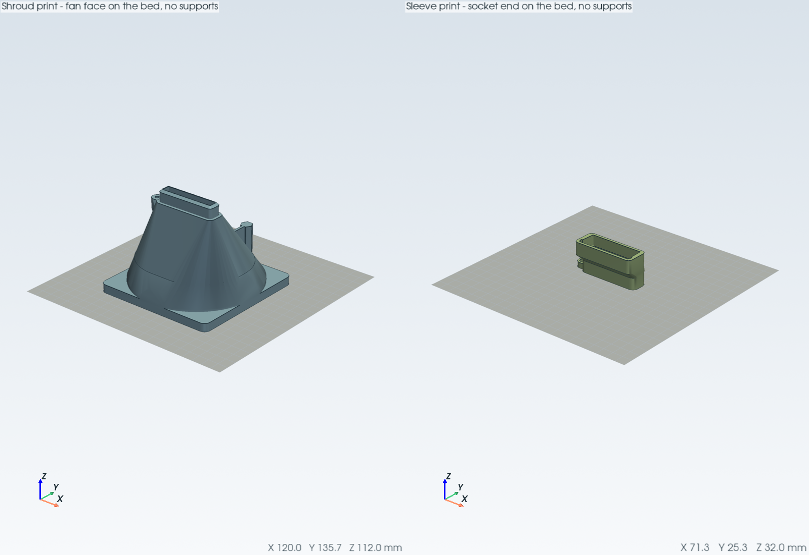
*`shroud_print`: fan face on the bed, no supports.*

- 0.4 mm nozzle, 6 perimeters (2.4 mm walls), 0.2 mm layers, 25-40 % infill.
- PETG: nozzle about 235-245 C, bed 75-85 C, part cooling 30-50 %. ASA: nozzle about 240-260 C, bed 95-105 C, part cooling 0-20 %, and print it in an enclosure (it warps). Use the filament maker's range if it differs. Not PLA for the final parts: warm case.
- Brim on the large flat flange face against warping. Put the seam on a non-sealing edge. Slow the outer walls (about 30-40 mm/s) for tight sleeve dimensions.
- Heat-set inserts: iron at about 220-250 C for PETG/ASA, press straight, then let it cool before screwing. Check your inserts' datasheet.
- Fit-check parts (`fitcheck_mouth`, `sleeve_print`, `fitcheck_interface`, `snap_comb` for a first pass) can be PLA.
- TPU for the foot pad and the `seal_ring` key (or use foam tape).

## Assembly order

1. Print `fitcheck_mouth`, then `sleeve_print` and `fitcheck_interface`; check the fit (below).
2. Print `snap_comb` and pick the clip interference (1.0-2.2 mm) that snaps without cracking.
3. Measure the drop from the hex bar to the separator; set `support_len`; print the shroud, the spacer, the clip, leg and foot, and TPU pads (and later `stator_layer_print` plus `stator_nose` for the A/B test; run the plain spacer first, as the control).
4. Press the M3 heat-set inserts into the shroud's flange (fan face, direct mount; the spacer's, if you use one).
5. Screw the fan to the flange from the fan side through its corner tabs (direct mount: this is the whole fan joint, skip the rest of this step and step 6's spacer join). With a spacer: on the bench, screw the fan to the spacer from the spacer's countersunk side with the M3x10 screws. Put the `seal_ring` key in the spacer's groove. With the stator: press the nose puck's peg into the layer's hub socket, then set the layer on the spacer (the ring keys the two, the puck sits in the spacer's bore against the fan hub).
6. Slide the shroud sleeve onto the card end until the block end face touches the flat stop; join the spacer (and layer: its tongue goes into the shroud's groove) with the screws from behind the flange lug.
7. Fit the clip on the hex bar, add the leg and foot, and adjust the foot to the separator.
8. Route the fan cable past the flange (not modelled). Load the GPU and watch `nvidia-smi`.

## Fit validation

Do this before trusting any dimension.

0. `fitcheck_fanface` (1 mm thick, fan side on the bed): lay it on the fan's contact face. Screw holes must line up, and the opening should follow the frame's flare with no step. The variants differ in `fan_flare_d`: `_d127` has 1 index hole, `_d132` 2, `_d137` 3 (the plain one has none). Pick the one that matches and set `fan_flare_d` to it. A real 137 mm flare needs a deeper bellmouth and a 14 mm spacer (the _d137 file already uses `flare_depth` 13 and `spacer_t` 14, the thinnest spacer that keeps the inserts and the key groove clear of that bellmouth); the 127 and 132 variants use the standard 12 mm spacer.
1. `fitcheck_mouth` (3 mm, a few minutes to print) must slip over the card end without forcing and without rattling; change `slide_clear`, `pcb_clear_extra`, `pcb_slot_extra_y` or `back_clear_extra` if not. Then `sleeve_print` must slide onto the card end until the block end face touches the flat step, with no binding, and the bare PCB edge must sit in its pocket without touching the pocket end. If it is too tight (binds) or too loose (rattles), change `slide_clear` (see the sleeve section) and reprint the sleeve.
2. `fitcheck_interface`: press the four heat-set inserts in (the insert should go in straight and end flush, with no plastic bulging around it), then screw the fan on from the fan side with the same M3x10 countersunk screws used everywhere else. Check that the screws pull the fan flat against the plate and that a screwdriver or hex key reaches the heads between the fan's corner flanges. The screw clamps the 4 mm fan tab (`fan_tab_t` [ASSUMED], measure it): if your tab is much thicker, the screw reaches less than the 4 mm insert. (With `stack_module = "spacer"` the coupon is the old 5.5 mm plate with the groove and the countersunk head pockets instead.)
3. Measure the fan's corner tab thickness `fan_tab_t` (4 mm assumed), check that the fan's corners are open enough to get a countersunk M3 head and a 2 mm hex key onto the tab, and measure the flare diameter `fan_open_d`.
4. Set the measured clearances (`clear_*`, `board_below`) and add anything else in `extra_keepouts`. `scripts/export.sh` fails if the shroud or fan envelope hits the card or a keep-out.
5. Only then set `params_confirmed = true` and run `scripts/export.sh --release`.

## Known limits

- The clip snap is untested; only printing `snap_comb` tests it.
- `support_len` is a placeholder (80 mm). `clear_behind_pcb` and `clear_x_beyond` are guesses; what lies beyond the card end (M.2, RAM) has to go in `extra_keepouts`.
- Fan blade count, tab thickness, flare diameters, and the insert and countersink details (`cs_clear`, `cs_land`) are assumed; the head size and 90 degree angle are DIN 7991 / ISO 10642 nominals, not measured. See `MEASUREMENTS.md`.
- Fin width, `fin_t`, and what fills the cover above the fins are unmeasured, so CFD pressure and bypass are uncertain.
- The CFD is steady RANS with a porous fin model and an assumed fan curve. Absolute flow is uncertain by 15 % or more, and there is no heat transfer.
- The stator layer is an untested A/B experiment; the diffuser is not in the CAD.
- 3000 rpm noise and vibration are not assessed.
- Still to measure: PCB edge thickness (calipers on the board edge; `pcb_t`), rotation direction (`stator_hand`), blade count and a P/Q curve, heat-set insert OD, `board_front_x`, `board_below`, `support_len`, `clear_behind_pcb`, `fin_t`. And the only real cooling result: `nvidia-smi` temperatures under load.

## License

Open hardware under the [CERN Open Hardware Licence v2, Permissive](LICENSE) (`CERN-OHL-P-2.0`), copyright 2026 Arthurdw.
You may use, modify, print and sell it; keep the [NOTICE](NOTICE), and note your changes if you share a modified version.
There is no warranty: the cooling is not validated, so check your GPU temperatures under load.
